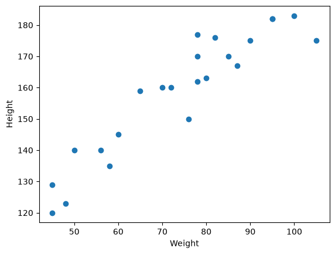
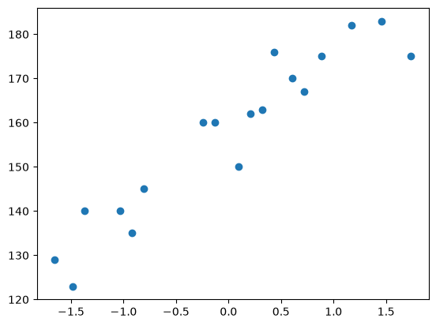
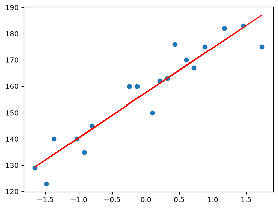
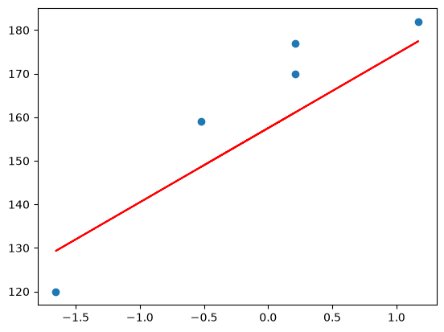
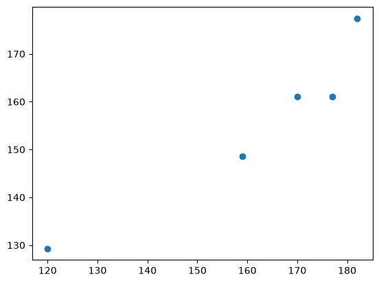
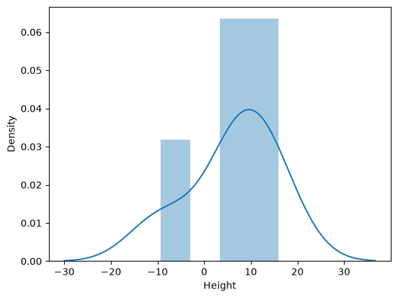
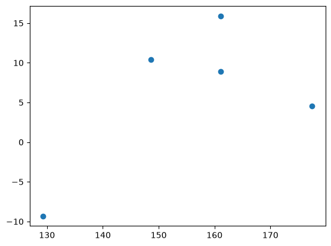

# 📏 Height Prediction using Simple Linear Regression

[](https://www.python.org/)
[](https://jupyter.org/)
[](https://scikit-learn.org/)
[](https://pandas.pydata.org/)
[](https://matplotlib.org/)

An end-to-end Machine Learning implementation of **Simple Linear Regression** to predict an individual's **Height** (in cm) based on their **Weight** (in kg). 

This project covers exploratory data analysis (EDA), data scaling using `StandardScaler`, model training with Scikit-Learn's `LinearRegression`, performance evaluation, and rigorous statistical validation of Linear Regression assumptions (Residual Analysis, Normality, and Homoscedasticity).

---

## 📑 Table of Contents
- [📌 Project Overview](#-project-overview)
- [📊 Dataset Description](#-dataset-description)
- [⚙️ Machine Learning Pipeline](#️-machine-learning-pipeline)
- [📈 Real Visualizations & Screenshots](#-real-visualizations--screenshots)
- [📐 Model Formulation & Coefficients](#-model-formulation--coefficients)
- [📉 Performance Evaluation](#-performance-evaluation)
- [🔬 Verification of Regression Assumptions](#-verification-of-regression-assumptions)
- [🔮 Inference Example](#-inference-example)
- [📁 Project Structure](#-project-structure)
- [🚀 Getting Started](#-getting-started)
- [💡 Suggested Project Names](#-suggested-project-names)

---

## 📌 Project Overview

Linear regression is a fundamental supervised learning algorithm used to model the linear relationship between a dependent target variable ($y$) and one or more independent predictor features ($X$).

In this study:
- **Independent Feature ($X$)**: Weight (kg)
- **Dependent Target ($y$)**: Height (cm)
- **Core Objective**: Learn the optimal regression line that minimizes the sum of squared residuals and evaluate how accurately height can be forecasted given a person's weight.

---

## 📊 Dataset Description

The dataset [`height-weight.csv`](height-weight.csv) contains recorded height and weight observations:

| Feature | Type | Description |
| :--- | :--- | :--- |
| **Weight** | Numeric (Continuous) | Independent variable / Predictor feature |
| **Height** | Numeric (Continuous) | Dependent target variable |

### Data Preview:
```text
Weight,Height
45,120
58,135
48,123
60,145
...
```

---

## ⚙️ Machine Learning Pipeline

1. **Exploratory Data Analysis (EDA)**: Initial visualization of correlation and distribution.
2. **Feature Separation**: Defining feature matrix $X = \text{df}[[\text{'Weight'}]]$ and target vector $y = \text{df}[\text{'Height'}]$.
3. **Train-Test Split**: Partitioning data using an 80/20 split (`test_size=0.2, random_state=42`).
4. **Standardization (`StandardScaler`)**: Normalizing the independent variable to zero mean and unit variance ($\mu = 0, \sigma = 1$) to ensure numerical stability and standard optimization.
5. **Model Training**: Fitting Ordinary Least Squares (OLS) `LinearRegression()`.
6. **Model Assessment**: Computing error metrics (MAE, MSE, RMSE, $R^2$, and Adjusted $R^2$).
7. **Assumption Validation**: Inspecting residuals for normality and homoscedasticity.

---

## 📈 Real Visualizations & Screenshots

Below are the actual visual outputs generated directly from the model training and evaluation notebook:

### 1. Exploratory Data Analysis: Weight vs. Height
A strong positive linear relationship is apparent in the raw scatter plot.



---

### 2. Standardized Training Feature Distribution
Feature standardization centering the training weight values:



---

### 3. Fitted Regression Line on Training Data
The optimal regression line fitted on the standardized training data ($\text{Intercept} = 157.5, \text{Slope} = 17.034$):



---

### 4. Model Predictions vs. Test Set
Visualizing generalization capability against unseen test observations:



---

## 📐 Model Formulation & Coefficients

The trained model computes the target height based on the standardized weight feature:

$$\hat{y} = \beta_0 + \beta_1 \cdot X_{\text{scaled}}$$

- **Intercept ($\beta_0$)**: `157.50`
- **Slope / Weight Coefficient ($\beta_1$)**: `17.0344`

**Linear Equation:**
$$\text{Predicted Height} = 157.50 + 17.0344 \times \left(\frac{\text{Weight} - \mu_{\text{train}}}{\sigma_{\text{train}}}\right)$$

---

## 📉 Performance Evaluation

The model was tested on an unseen holdout set (20% of data), yielding the following metrics:

| Metric | Value | Description |
| :--- | :--- | :--- |
| **Mean Absolute Error (MAE)** | **9.82 cm** | Average absolute difference between predicted and actual heights |
| **Mean Squared Error (MSE)** | **109.78** | Average squared deviation penalizing larger errors |
| **Root Mean Squared Error (RMSE)** | **10.48 cm** | Standard deviation of the prediction errors |
| **$R^2$ Score (Coefficient of Determination)** | **0.7770 (77.7%)** | Proportion of height variance explained by weight |
| **Adjusted $R^2$ Score** | **0.7026 (70.3%)** | $R^2$ adjusted for degrees of freedom and sample size |

---

## 🔬 Verification of Regression Assumptions

To confirm that Linear Regression is mathematically valid for this dataset, standard regression diagnostics were tested:

### 1. Actual vs. Predicted Correlation
Points clustered along the diagonal confirm positive correlation between actual and predicted heights.



### 2. Normality of Residuals
$$\text{Residuals} = y_{\text{test}} - \hat{y}_{\text{pred}}$$
The error distribution follows an approximately normal distribution curve (KDE):



### 3. Homoscedasticity (Uniform Variance of Residuals)
Scatter plot of residuals against predicted values exhibits uniform spread, confirming constant variance across prediction ranges.



---

## 🔮 Inference Example

To predict the height for an individual weighing **80 kg**:

```python
import numpy as np

# Sample input
new_weight = [[80]]

# Scale using the previously fitted scaler
scaled_weight = scaler.transform(new_weight)

# Predict height
predicted_height = lin_reg.predict(scaled_weight)
print(f"Predicted Height for 80 kg: {predicted_height[0]:.2f} cm")
# Output: Predicted Height for 80 kg: 163.01 cm
```

---

## 📁 Project Structure

```text
Project2/
│
├── assets/                                   # Real plot screenshots extracted from execution
│   ├── 01_weight_vs_height_scatter.png
│   ├── 02_scaled_training_scatter.png
│   ├── 03_regression_line_training.png
│   ├── 04_regression_line_test.png
│   ├── 05_actual_vs_predicted.png
│   ├── 06_residuals_distribution.png
│   └── 07_residuals_vs_prediction.png
│
├── height-weight.csv                         # Biometric dataset (Weight, Height)
├── height_weight_linear_regression.ipynb     # Main Jupyter Notebook with data pipeline & plots
└── README.md                                 # Project documentation & analysis report
```

---

## 🚀 Getting Started

### Prerequisites
Make sure Python 3.8+ and Jupyter Notebook / JupyterLab are installed.

### Installation
Clone or navigate into the repository:
```bash
git clone <repository-url>
cd height-weight-linear-regression
```

Install the required dependencies:
```bash
pip install pandas numpy scikit-learn matplotlib seaborn jupyter
```

### Running the Notebook
Launch Jupyter Notebook:
```bash
jupyter notebook height_weight_linear_regression.ipynb
```

Execute all cells sequentially (`Kernel` -> `Restart & Run All`) to reproduce the model weights, metrics, and visual plots.

---

